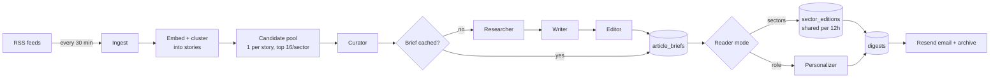

# Brieff

A personalised daily news brief, built by a multi-agent LLM pipeline, with a source link on every item.

## What it does

Readers pick sectors (or describe their role), a delivery time and a reading depth. Brieff
pulls dozens of RSS feeds every 30 minutes and groups articles from different outlets
that cover the same story. At each reader's local delivery time it emails a sourced brief,
which is also kept in an in-app archive. Every claim is checked against the source text before
it ships. Thumbs up/down feedback is condensed into a reader profile that changes what the
Curator picks on later runs. Every pipeline run is logged stage by stage (tokens, timings, Curator
reasons, Editor rejections) on an admin `/runs` page.

## Architecture



**Agent pipeline** (`lib/agents/`)

- **Curator** (fast model) ranks a pre-filtered pool against the reader's role, keywords and
  feedback profile, and returns a score and a one-line reason for each pick. It selects a few
  extra per sector, so a rejected item is replaced by the next-best pick instead of triggering a retry.
- **Researcher** (no LLM) fetches full article text through `r.jina.ai` (8s timeout,
  concurrency 10), caches it on the article row, and falls back to the RSS excerpt on failure.
- **Writer + Editor, shared per article.** A neutral Writer (batched 6 articles per call) produces a headline,
  summary, why-it-matters and 3-5 key facts. An Editor checks every claim against the source.
  The result is stored once in `article_briefs` and reused by every reader whose Curator picks that
  article, so nothing is spent on the many articles no one selects.
- **Personalizer** (role readers only) rewrites why-it-matters for the reader's role in one
  batched call, and a second call verifies each line against the key facts. Lines that fail
  verification fall back to the neutral text.

**Two editions** (`lib/agents/edition.ts`)

- **Sector edition**: one neutral, Editor-verified edition per sector per 12h UTC bucket,
  built by the first reader who needs it and shared by everyone after that. A sector-mode digest makes no
  per-user model calls.
- **Role-tuned brief**: the per-reader path, with its own Curator run, the shared briefs, the Personalizer and a
  cross-sector editor's note.

**Story clustering** (`lib/story-index.ts`, `lib/clustering.ts`). After ingestion, new
articles are embedded (`text-embedding-3-small`, 256 dims) and assigned to a story. Similarity
of 0.88 or higher merges outright. Between 0.76 and 0.88 a merge needs the titles to share a specific token
(a 3+ digit number or a distinctive proper name), because embeddings alone score
"same template, different company" as high as true duplicates do. Similarity is computed in app code over
`real[]` columns, so pgvector is not needed.

**Job queue and scheduling** (`lib/jobs/`, `lib/cron/`)

```
GitHub Actions (*/15) ──> POST /api/cron/dispatch
                            │  enqueue `generate` job per user due within 45 min
                            │  CAS-claim the slot (next_run_at -> following slot)
                            └─> fan out N parallel POST /api/jobs/worker
worker: claim batch (FOR UPDATE SKIP LOCKED, 6-min lease)
        generate -> digest stored -> enqueue `send` with run_after = slot
        send     -> re-check recipient -> deliver (idempotent)
```

- Generate early, send on time: briefs are built in the 45 minutes before the slot, and each email
  goes out on the first tick at or after the slot.
- Enqueue-then-claim ordering, plus unique indexes on `(kind, user_id, scheduled_for)` and
  `(user_id, scheduled_for)`, means a crash can only cause a no-op duplicate. A slot is never lost
  and a brief is never sent twice.
- If a worker dies, its lease expires and another worker reclaims the job. A job fails permanently after 3 attempts,
  with backoff between them.

## Engineering highlights

- **Token cost cut at the source.** Story dedup plus embedding-ranked candidate pools cut
  Curator input from ~25.9k to ~2.4k tokens. A warm role-tuned digest went from ~30k to
  ~10.5k tokens. A sector-mode digest costs **0 tokens**, and an edition build costs ~16k tokens per sector every 12h.
- **Fast dispatch.** 500 users due in the same slot are enqueued in ~180ms. The dispatcher only enqueues,
  and throughput scales with parallel workers.
- **Single-flight edition builds** via `pg_advisory_xact_lock` on (sector, bucket). Concurrent
  readers wait and then read the stored edition instead of paying for a second build.
- **One LLM wrapper** (`lib/llm.ts` is the only file that imports `openai`). It uses structured output
  and validates every response against a zod schema. A failed validation is retried once with the error fed back to the model, and a second
  failure returns a typed `degraded` result instead of throwing. Transient 429/5xx errors are retried with
  exponential backoff and jitter. Token usage is recorded per stage.
- **Every brief item has a source URL**, enforced by a `NOT NULL` constraint and by the pipeline, which
  drops and logs any item whose source can't be resolved.
- **Resilient ingestion.** Each feed runs in its own try/catch. A source is auto-disabled after
  3 consecutive failures.
- **Passwordless auth.** Sign-in uses one-time email links. Only SHA-256 hashes of tokens are stored,
  links are rate-limited, and the link is spent by a POST, so mail scanners that prefetch it can't burn it.
- **Email compliance.** Every email has an RFC 8058 one-click unsubscribe (`List-Unsubscribe-Post`) backed by
  HMAC-signed, purpose-bound tokens. A Svix-verified Resend webhook suppresses hard bounces and
  complaints.
- **Fail-closed internal API.** Every route that spends money requires a bearer secret. The browser
  reaches those routes only through session-checked server actions and proxies. The only public LLM route (the landing-page
  demo) is limited by a per-IP rate limit (IPs stored as hashes) and hard caps on input size.
- **All times stored as UTC `timestamptz`.** Times are converted to the reader's timezone only for display (Luxon).

## Tech stack

Next.js 16 (App Router), React 19, TypeScript, Tailwind CSS v4, shadcn/ui · Postgres +
Drizzle ORM · OpenAI API (chat + embeddings) · Resend + react-email · Luxon · rss-parser ·
GitHub Actions cron · Vercel

## Running locally

Requires Node.js 20+ and a Postgres database.

```bash
npm install
cp .env.example .env.local   # fill in the values below
npm run db:migrate           # apply migrations
npm run db:seed              # load the RSS source list
npm run dev                  # http://localhost:3000
```

| Variable | Purpose |
| --- | --- |
| `DATABASE_URL` | Postgres connection string |
| `OPENAI_API_KEY` | OpenAI API key (used only by `lib/llm.ts`) |
| `MODEL_WRITER` | Model for the Writer. Required at startup |
| `MODEL_FAST` | Model for the Curator, Editor, Personalizer and feedback profile. Required at startup |
| `MODEL_EMBEDDING` | Optional. Embedding model (default `text-embedding-3-small`) |
| `JINA_API_KEY` | Optional. Raises the `r.jina.ai` rate limit for full-text fetches |
| `RESEND_API_KEY` | Resend key. If left empty, emails and sign-in links are printed to the server log instead of sent |
| `RESEND_WEBHOOK_SECRET` | Signing secret for `/api/webhooks/resend` (bounces and complaints). The route returns 503 until this is set |
| `CRON_SECRET` | Bearer token for the internal routes and cron. Also the key from which signed-link keys are derived. If unset, those routes refuse every request |
| `NEXT_PUBLIC_APP_URL` | Base URL for links in emails, e.g. `http://localhost:3000` |
| `WORKER_FANOUT` | Optional. Max parallel workers the dispatcher starts per tick (default 4) |
| `EMAIL_FROM` | Optional. Sender address (defaults to Resend's test sender) |
| `EMAIL_POSTAL_ADDRESS` | Postal address shown in the email footer |
| `NEXT_PUBLIC_CONTACT_EMAIL` | Contact address shown in the app |

Useful scripts:

```bash
npm run digest:test <userId>   # run the full pipeline for one user as a dry run (nothing saved or sent)
npm run watch                  # poll the dispatcher every 60s (local stand-in for the cron)
npm run db:studio              # browse the database
```

In production, two GitHub Actions workflows drive the app. `ingest.yml` runs every 30 minutes and
`dispatch.yml` every 15. Both need the `DISPATCH_URL` and `CRON_SECRET` repository secrets.

## Tests

```bash
npm test   # node --test over lib/**/*.test.ts
```

Requires `DATABASE_URL` (a reachable Postgres) and `CRON_SECRET`. The database tests cover the
queue race, lease expiry and the attempt cap, the dispatcher's claim race, and suppression. The unit tests
cover scheduling math, clustering, retries, signed links, rate limiting and brief caching.

## Project structure

```
app/                  routes: landing, onboarding, sign-in, dashboard, archive, /runs, API
  api/cron/dispatch   scheduler entry point
  api/jobs/worker     queue worker
components/           UI (shadcn/ui primitives in components/ui)
lib/
  agents/             Curator, Researcher, briefs (Writer/Editor), Personalizer, editions, pipeline
  jobs/               Postgres job queue, worker, handlers
  cron/               dispatcher
  email/              react-email template, delivery, Resend webhook
  auth/               magic-link sign-in
  db/                 Drizzle schema, seed, source list
  llm.ts              the single LLM wrapper
  ingest.ts           RSS ingestion
  story-index.ts      embedding + story clustering
drizzle/              SQL migrations
scripts/              dev scripts (dry-run digest, dispatcher poller)
.github/workflows/    ingest and dispatch crons
```

## License

Proprietary. All rights reserved. The source is published for viewing only. See [LICENSE](LICENSE).
